# Assignment 1 — Observability Report

**Secret Identity**  
Enterprise Software Development, Fall 2026

**Name:** Syed Hamza Omer  
**Student ID:** 08962

---

## Part A — Project

**Problem.** I wanted a short browser game in the style of Wordle, but for DC characters instead of letters. Players get attribute clues after each guess and try to find the secret character before they run out of attempts.

**Users.** Anyone who knows comic characters roughly and wants a quick round — no account, no install.

**Solution.** A single Node/Express app (`app/server.js`). The server picks a character from `characters.json`, keeps the answer, and returns match / partial / higher / lower feedback per attribute. Games end on a correct guess or after 8 tries.

**How to try it**

```bash
docker compose up -d --build
```

Open http://localhost:8000, start a game, type a character name, and guess. For traffic on the dashboards: `node scripts/load.js --duration 60`.

What works: new games, guesses with feedback, win/lose, Prometheus `/metrics`, JSON logs on stdout, and the chaos endpoints used in Part E.

---

## Part B — Metrics

Prometheus scrapes the app every 5s. Grafana shows the charts below. Node Exporter scrapes the **Docker Desktop Linux VM**, labeled `machine="docker-desktop-linux-vm"`.

### Metric list

| Metric | Purpose | Type | Unit | Labels | Recorded in |
| --- | --- | --- | --- | --- | --- |
| `http_requests_total` | Request volume and failures | Counter | requests | `method`, `route`, `status_code` | Request middleware in `server.js` |
| `http_request_duration_seconds` | Latency distribution / p95 | Histogram | seconds | `method`, `route` | Same middleware (`startTimer`) |
| `games_active` | Games currently in progress | Gauge | games | — | Gauge `collect()` over the in-memory map |
| `guesses_per_game` | Guesses used when a game ends | Summary | guesses | `result` | On win/loss (~10 min window) |
| `games_started_total` / `games_finished_total` | Business volume | Counter | games | `result` on finished | Game routes |
| `guesses_by_character_total` | Which characters get guessed most (my own metric) | Counter | guesses | `character` | On each accepted guess |
| `demo_requests_total` | Cardinality demo only | Counter | requests | optional `request_id` | `POST /api/demo/hit` |
| `node_*` | CPU, memory, disk, network | various | various | `machine` | Node Exporter |

All four Prometheus types are used across the project (not four per category).

### Dashboards created

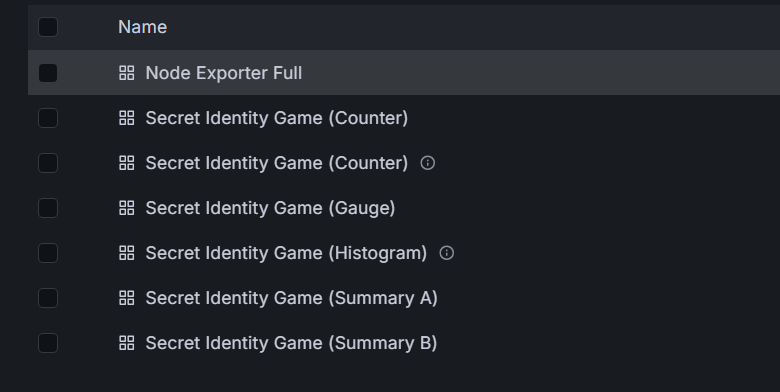

*Figure B.1 — Grafana dashboards for each metric type plus Node Exporter Full.*

### Application metrics

**Counter — RPS by route**

```promql
sum by (route) (rate(http_requests_total[1m]))
```

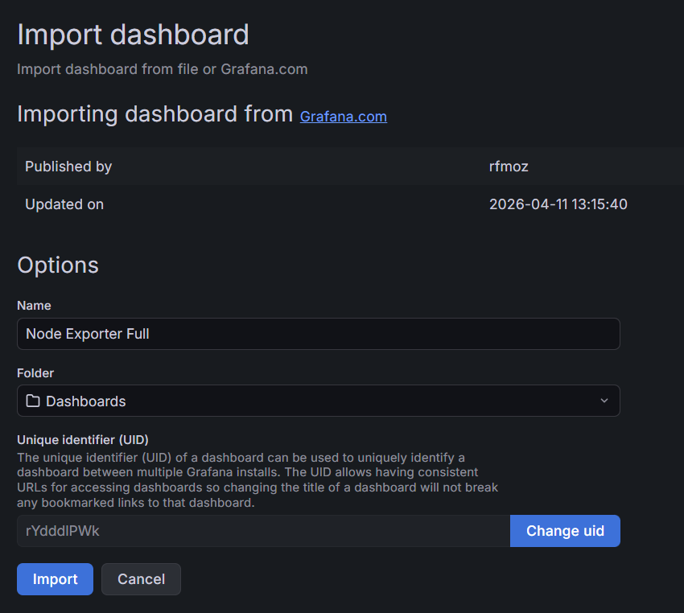

*Figure B.2 — Requests/sec during load. Guess traffic dominates, as expected.*

**Counter — failed requests**

```promql
sum by (status_code) (rate(http_requests_total{status_code!~"2.."}[1m]))
```

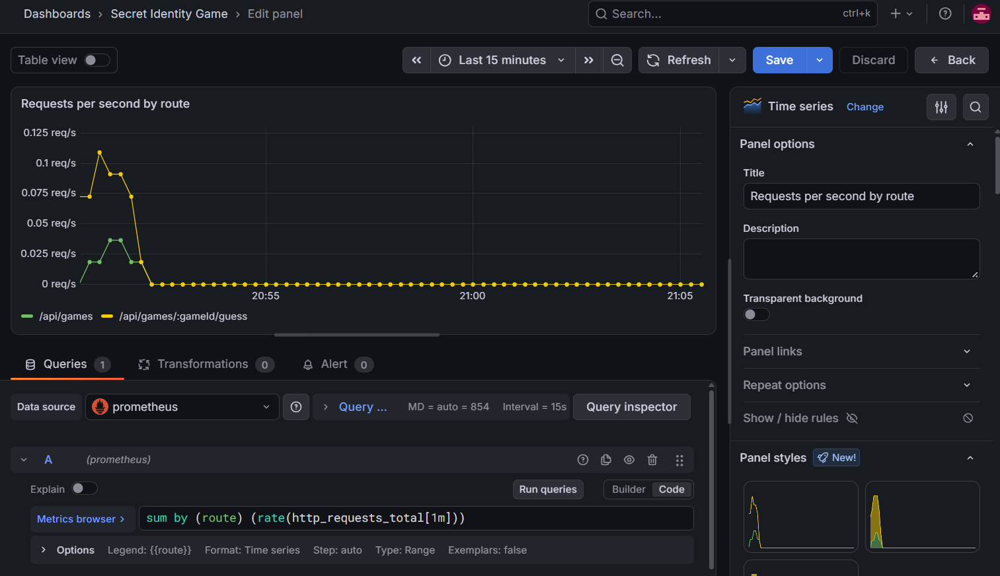

*Figure B.3 — Non-2xx traffic (e.g. bad guesses → 400). Useful when something is wrong with clients or validation.*

Raw counter samples from `/metrics`:

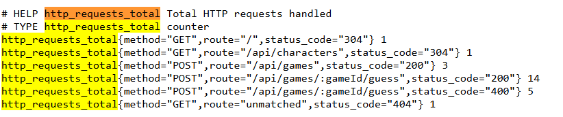

*Figure B.4 — What Prometheus actually scrapes for `http_requests_total`.*

**Histogram — p95 latency**

```promql
histogram_quantile(0.95, sum by (le, route) (rate(http_request_duration_seconds_bucket[5m])))
```

The `[5m]` is the rate window Grafana uses to estimate the quantile.

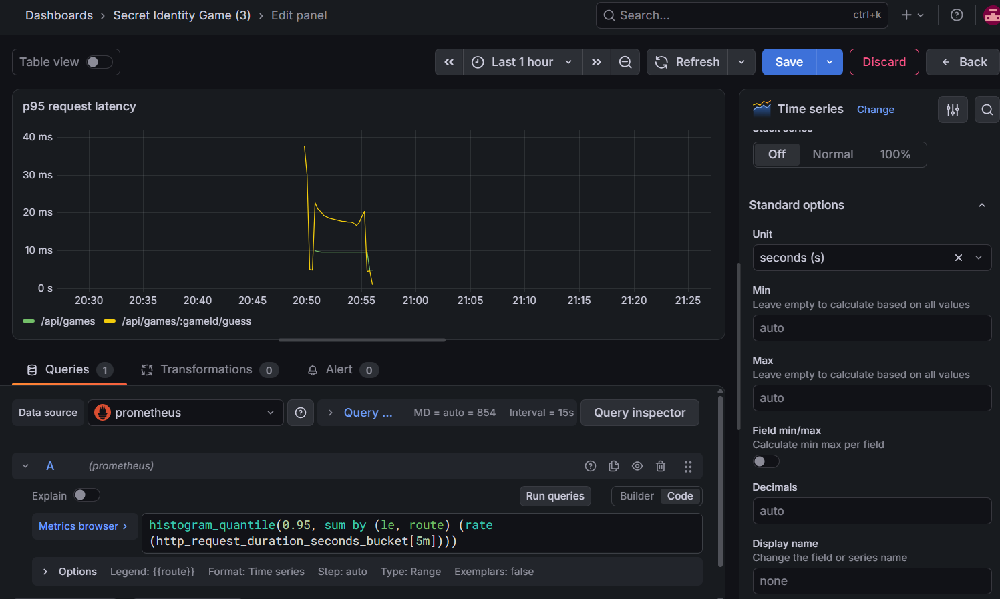

*Figure B.5 — p95 by route under normal play (low tens of ms).*

### Business metrics

**Gauge — active games**

```promql
games_active
```

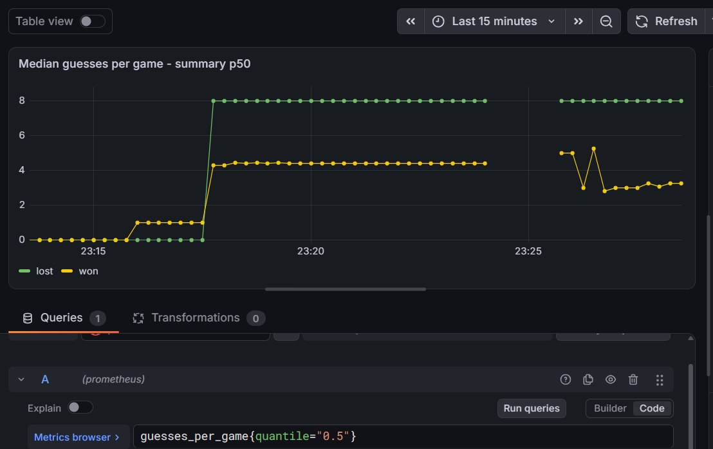

*Figure B.6 — In-progress games during a load run (rises, holds, then drops when games finish or the test stops).*

**Summary — average guesses**

```promql
sum(rate(guesses_per_game_sum[10m])) / sum(rate(guesses_per_game_count[10m]))
```

**Summary — median (p50)**

```promql
guesses_per_game{quantile="0.5"}
```

The summary is configured with `maxAgeSeconds: 600`, so percentiles cover roughly the last 10 minutes.

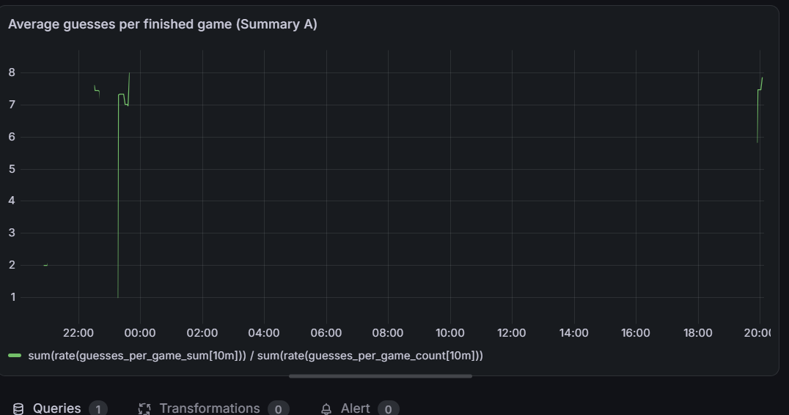

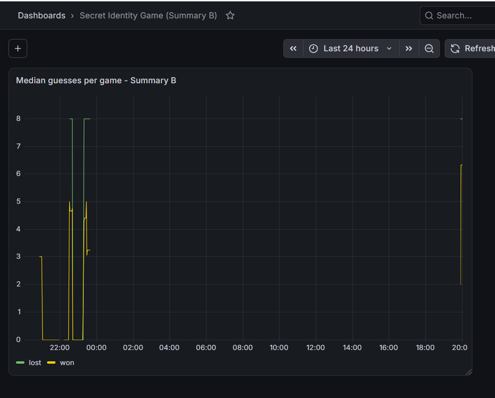

*Figures B.7–B.8 — Average and median guesses. Lost games sit at 8 (the max); wins are lower.*

### Metric I explored myself

`guesses_by_character_total` — which characters players try most. The label is bounded by the roster size, so cardinality stays safe.

```promql
topk(10, sum by (character) (guesses_by_character_total))
```

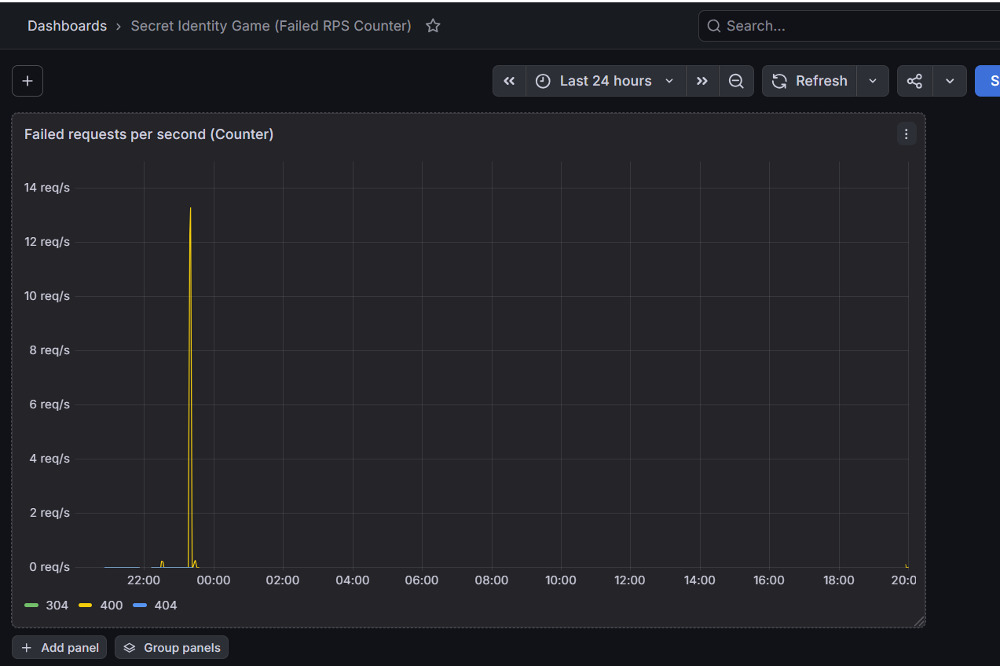

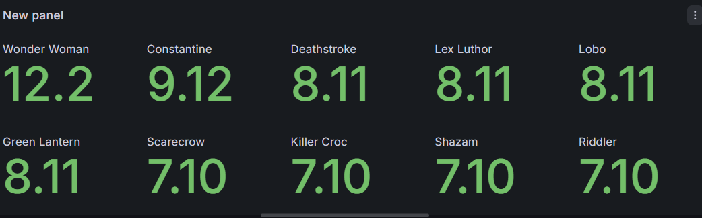

*Figures B.9–B.10 — Top guessed characters (Wonder Woman leading in this run).*

### Node Exporter

Machine name in Prometheus: **`docker-desktop-linux-vm`**. I imported the community **Node Exporter Full** dashboard for CPU, memory, disk, and network.

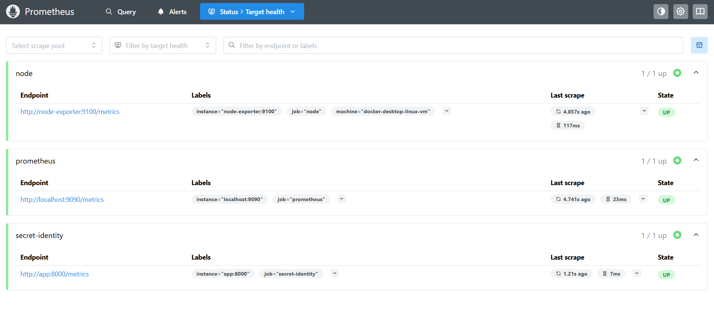

*Figure B.11 — Host/VM overview (CPU mostly idle, ~8 GiB RAM, uptime of the Docker Desktop Linux VM).*

---

## Part C — Logs

### What I log

| Event | Why | Where |
| --- | --- | --- |
| `request completed` | Every request: method, route, status, `duration_ms`, `request_id` | Middleware |
| `game started` / `guess made` / `game finished` | Business trail without leaking the secret mid-game | Game routes |
| `guess rejected` | Bad/unknown/duplicate guesses | Guess validation |
| `chaos delay injected` | Part E fault visibility | Chaos middleware |
| errors | Unexpected failures | Error handler |

Severity is `info` / `warn` / `error`. I do **not** log IPs, user-agents, passwords, or the secret character while a game is running.

### Pipeline

App writes one JSON object per line on stdout → Docker stores container logs → Filebeat (only containers with `co.elastic.logs/enabled=true`) unwraps Docker’s JSON and decodes the app JSON into fields → Elasticsearch index `secret-identity-logs-*` → Kibana Discover.

Config: `filebeat/filebeat.yml`. Same idea as Lab 1 (Midnight Launch).

### Where logs live

| Place | Survives restart? | Cleared by |
| --- | --- | --- |
| Docker container logs | Until rotate / container remove | Docker log rotation |
| Elasticsearch `esdata` volume | Yes | `docker compose down -v` |
| Filebeat registry | Yes | `down -v` |

ILM is off for this local stack, so daily indices stay until the volume is removed.

### Searching in Kibana

Data view: `secret-identity-logs-*`, timestamp `@timestamp`.

Example original line (stdout):

```json
{"level":"info","service":"secret-identity","request_id":"…","method":"POST","route":"/api/games","status_code":200,"duration_ms":3.2,"message":"request completed","@timestamp":"2026-09-23T11:00:00.000Z"}
```

After Filebeat, the same fields are searchable, plus container metadata (`container.name`, etc.).

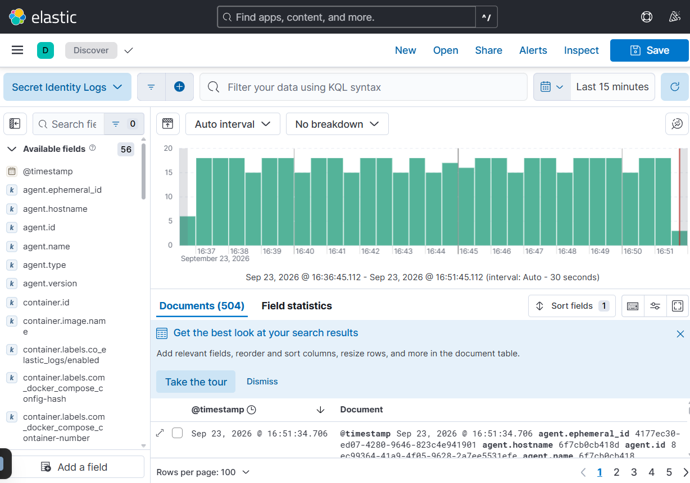

*Figure C.1 — Discover with the Secret Identity Logs data view (504 documents in 15 minutes during a load run).*

Useful searches:

```kql
service: "secret-identity"
request_id: "<paste-uuid>"
level: error or level: warn
message: "chaos delay injected"
```

More examples: `kibana/queries.md`.

---

## Part D — System design

### Architecture

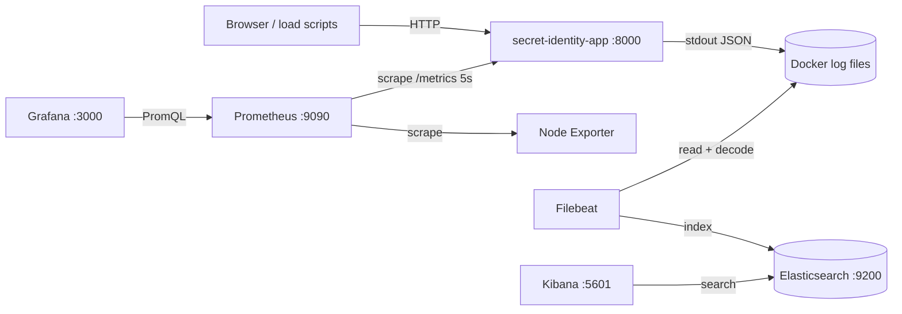

| If this stops… | What happens |
| --- | --- |
| App | Players fail; metrics/logs go stale |
| Prometheus / Grafana | Game still works; charts empty/stale |
| Filebeat | Logs stay on disk only |
| Elasticsearch | Kibana cannot search; Filebeat retries |
| Kibana | Data still in ES |

I chose this split because metrics want low-cardinality numbers, while logs can carry high-cardinality fields like `request_id`. I am not claiming to know every line of Prometheus/Filebeat source — mainly how they talk to each other in this compose file.

### Follow one metric

`http_request_duration_seconds`: middleware starts a timer → value appears on `/metrics` → Prometheus scrapes → Grafana runs the p95 query above. Path is visible in Figures B.4–B.5 and again in Part E when latency jumps.

### Follow one log

`request completed` JSON on stdout → Filebeat decode → document in ES → find it in Kibana with `request_id` or `message: "request completed"` (Figure C.1).

---

## Part E — Experiments

### E.1 Slow requests

**Fault:** every 5th request sleeps 500 ms (`POST /chaos/delay?every=5&ms=500`).

**Prediction:** p95 / average latency rise; warn logs with `chaos delay injected`; players feel intermittent lag.

**Method:** `node scripts/experiment-delay.js` (baseline → inject → recover), each stage long enough for several 5s scrapes.

| Stage | p95 (approx., start-game route) |
| --- | --- |
| Baseline | ~5 ms |
| Delay on | ~853 ms |
| After recover | ~5 ms |

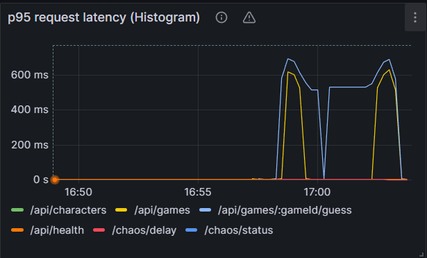

*Figure E.1 — p95 spike while the delay was active, then return toward normal. `/api/games` and guess routes move together; health stays flat.*

**Cause / user effect.** Artificial sleep before handling the request, so ~1 in 5 actions feels half a second slow. Clearing the delay (`every=0`) restores normal latency. Matching logs: `message: "chaos delay injected"` in Kibana.

### E.2 Cardinality

**Unsafe build:** `ENABLE_CARDINALITY_LABEL=1` so `demo_requests_total` has a `request_id` label. Hit `/api/demo/hit` with 100 unique IDs (capped at 100).

**Safe build:** rebuild with the label off and hit again.

| Mode | `count(demo_requests_total)` after scrape |
| --- | --- |
| With `request_id` label | **100** |
| Without label (restart) | **1** |

Commands: see README / `scripts/experiment-cardinality.js`.

At larger scale, one unbounded label creates a new time series per value and burns Prometheus memory. That is why IDs belong in **logs**, not metric labels. Removing the label does not instantly erase old series from history — only new scrapes stop growing.

---

## Sources / credit

- ESD Lab 1 (Midnight Launch) — Filebeat / ES / Kibana pattern
- Prometheus docs on metric types and label cardinality
- Grafana “Node Exporter Full” community dashboard (rfmoz)
- Cursor assistance for wiring compose and experiment scripts

---

*Images live in `report-images/`. Config and dashboards are in the repo; run instructions are in `README.md`.*
