# Assignment 2 — HTTP APIs, gRPC, and Metrics

**Secret Identity**  
Enterprise Software Development, Fall 2026

**Name:** Syed Hamza Omer  
**Student ID:** 08962

This is the same DC guessing game from Assignment 1. Players still try to name the secret character in eight guesses. This round I cleaned up the HTTP API, added a gRPC twin of the same game logic, and filled the metric gaps that showed up once a second protocol was in the mix.

```bash
docker compose up -d --build
```

| What | Where |
| --- | --- |
| Game UI | http://localhost:8000 |
| OpenAPI / Swagger | http://localhost:8000/api/docs |
| Spec file | http://localhost:8000/openapi.yaml |
| gRPC | `localhost:50051` |
| gRPC metrics | http://localhost:9091/metrics |
| Prometheus targets | http://localhost:9090/targets |
| Grafana | http://localhost:3000 (`admin` / `admin`) |

```bash
python scripts/test_http_api.py
python scripts/test_rate_limit.py
python scripts/http_caller.py
python scripts/grpc_caller.py 5
```

---

## Part A — Improve the HTTP API

### REST table

| Method | Route | Inputs | Success / errors | Notes |
| --- | --- | --- | --- | --- |
| `GET` | `/api/health` | — | `200` | Liveness check. Unchanged from A1. |
| `GET` | `/api/characters` | — | `200` | 43 names. Read-only, so repeats are already safe. |
| `POST` | `/api/games` | optional `Idempotency-Key` | `201` new, `200` replay | Same key returns the same `game_id`. |
| `POST` | `/api/games/{gameId}/guesses` | body `{"name":"..."}`, optional `Idempotency-Key` | `200`, `400`, `404`, `409`, `429` | Main change this assignment. |
| `POST` | `/api/games/{gameId}/guess` | same | same | A1 alias so old callers still work. |
| `GET` | `/api/games/{gameId}` | path id | `200`, `404` | Status, guesses used, turns left. |
| `GET` | `/openapi.yaml` | — | `200` | The spec itself. |
| `GET` | `/api/docs` | — | `200` | Swagger UI over that spec. |
| `GET` | `/metrics` | — | `200` | HTTP Prometheus scrape. |
| `POST` | `/chaos/delay`, `/chaos/reset` | query `every`, `ms` | `200`, `400` | Used to force timeouts for the caller demo. Left as lab tools. |

Chaos, `/metrics`, and `/api/demo/hit` are A1 leftovers. I did not redesign them.

### OpenAPI (three sentences)

`openapi.yaml` is an OpenAPI 3.0.3 document for the HTTP routes above: path params, JSON bodies, success payloads, and the error codes I actually return (`400`, `404`, `409`, `429`). The app serves that file at `/openapi.yaml` and loads it in Swagger UI at `/api/docs`, so I can click an operation instead of reconstructing curl by hand. I used it to try `POST /api/games/{gameId}/guesses` in the browser — fill `gameId`, send `{"name":"Batman"}`, and read the clue object plus the `Idempotent-Replayed` / rate-limit headers.

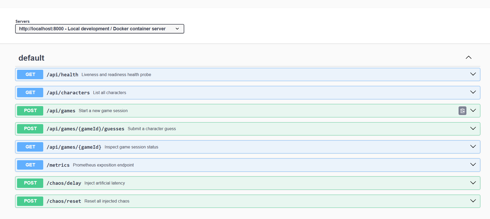

*Figure 1. Swagger UI at `/api/docs`, generated from `openapi.yaml`.*

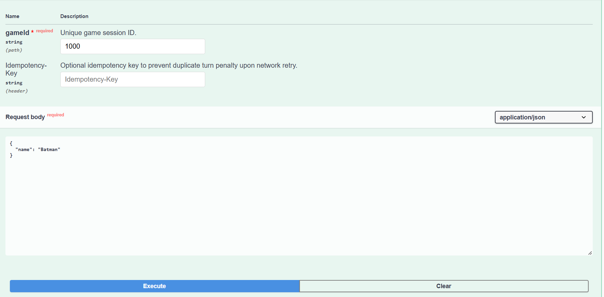

*Figure 2. Trying a guess from the spec. `Idempotency-Key` is an optional header on the same operation.*

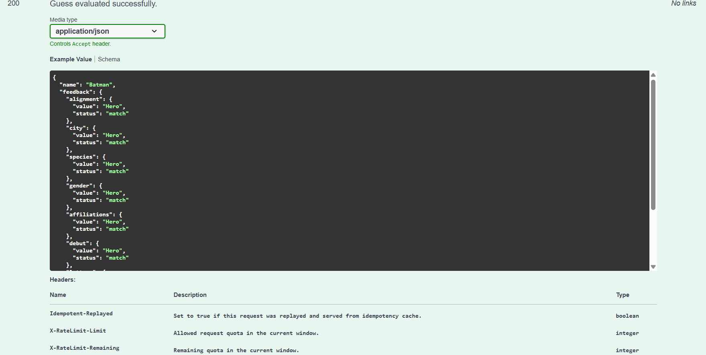

*Figure 3. Live `200` from that try-it call. The spec also documents `Idempotent-Replayed` and the `X-RateLimit-*` headers.*

### Before / after: submitting a guess

The user task I picked is **submit a character guess in an active game**.

| | Assignment 1 | Assignment 2 |
| --- | --- | --- |
| **Old / new endpoint** | `POST /api/games/:gameId/guess` | `POST /api/games/:gameId/guesses` (legacy `/guess` still mapped) |
| **Problem** | Singular URI; a dropped response plus a retry looked like a second guess (`400 You already guessed that character`); no throttle, so a script could burn through the 43-name roster. | Collection URI; `Idempotency-Key` replays cached feedback and does not spend a turn; 5 calls / 10s per IP, then `429` + `Retry-After`. |
| **Change** | One POST that always mutated. | Same judging code, plus a key cache, a sliding window, and headers that tell the caller what happened. |
| **Reason** | Guesses are the write that actually costs a turn. That is the call a flaky client will retry, and the one worth rate-limiting. |

**Other endpoints**

- `POST /api/games` — also takes `Idempotency-Key`. A retry should not spawn a second secret.
- `GET /api/games/:gameId` — added so you can inspect a session without guessing.
- `GET /api/characters`, `GET /api/health` — left alone. GETs with no body.
- `/chaos/*`, `/metrics`, `/api/demo/hit` — left alone. Lab / A1 surfaces.

**Callers I had to touch**

- Browser client (`app/static/index.html`) now posts to `/guesses` and sends a UUID `Idempotency-Key` on start-game and guess.
- `scripts/load.js` hits `/guesses` and treats `200`/`201` as success.
- New Python caller: `scripts/http_caller.py` (below).

### Idempotency

`POST /api/games` and `POST /api/games/:id/guesses` are the retries that would duplicate work.

The client sends `Idempotency-Key`. The engine stores the response against that key (`app/game-engine.js`). The next POST with the same key returns the cached body and `Idempotent-Replayed: true`. Guesses_left does not drop.

Repeating the same character name in one session is also treated as a replay even without a key, because that used to be the exact A1 failure mode after a timeout.

### Rate limiting

- **Limit:** 5 requests in a 10 second sliding window.
- **Who shares it:** one bucket per client IP, in this process only (single instance is enough for the brief).
- **When you may call again:** `429 Too Many Requests` with `Retry-After` set to how many seconds until the oldest stamp in the window ages out. `X-RateLimit-Limit`, `X-RateLimit-Remaining`, and `X-RateLimit-Reset` go out on both allowed and blocked responses.

I ran this separately from the circuit-breaker demo, as asked (`python scripts/test_rate_limit.py`).

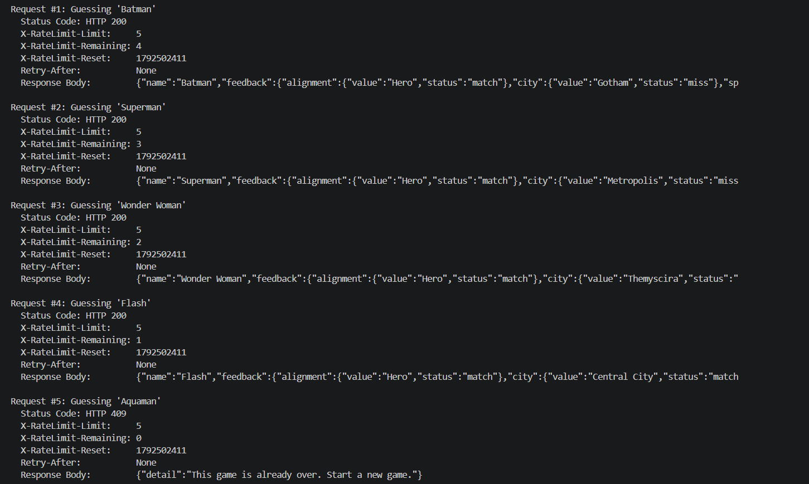

*Figure 4. Accepted guesses on `POST /api/games/{id}/guesses`. Remaining quota counts down. Request 5 landed on a finished game (`409`) after a lucky correct guess, so the remaining counter is already 0; the next burst is what Grafana records as `429` (Figure 11).*

The automated API suite also hit the cap while checking the `/guess` alias and waited on `Retry-After` (~10.5s) before continuing:

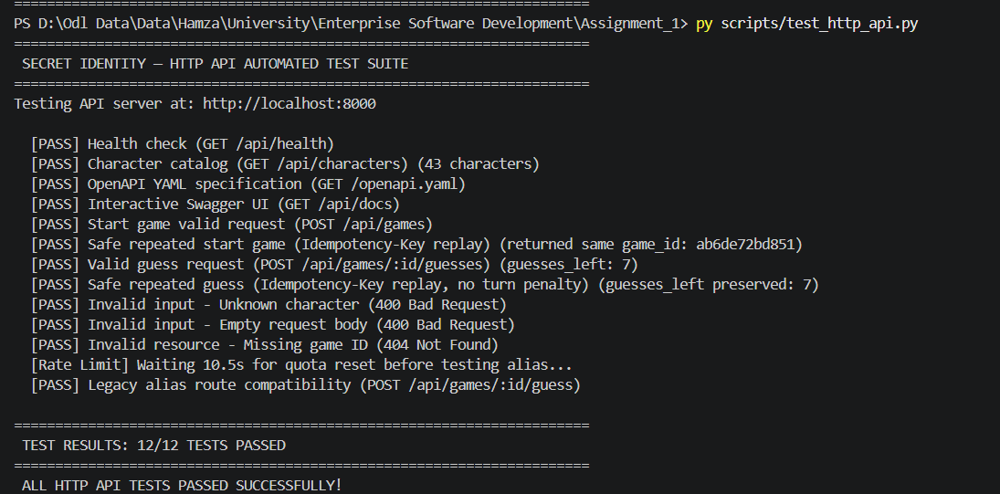

*Figure 5. Valid request, invalid input (`400` unknown character, empty body, `404` missing game), and a repeated start/guess with the same key. The “Waiting 10.5s” line is the `429` path.*

### Tests I ran on HTTP

| Case | What I sent | Result |
| --- | --- | --- |
| Valid | `POST /api/games`, then guess `Batman` | `201` / `200`, clues, guesses_left 7 |
| Invalid | `Thanos-Marvel`, empty body, fake game id | `400`, `400`, `404` |
| Repeat | same `Idempotency-Key` on start and on guess | same `game_id`; guess replayed; guesses_left unchanged |

### Python HTTP caller

`scripts/http_caller.py` is a client, not another server. One run makes several calls with:

| Setting | Value |
| --- | --- |
| Timeout | **1.0 s** per attempt |
| Retries | **3** extra attempts on timeout / connection error / HTTP 5xx |
| Backoff | 0.2 s, 0.4 s, 0.8 s |
| Breaker trip | **3** consecutive exhausted calls |
| Recovery | **3.0 s** closed-to-traffic, then one HALF_OPEN probe |

Retries reuse the same `Idempotency-Key`, so a late server response cannot spend extra turns.

I did **not** use rate limiting for this demo. Timeouts come from `POST /chaos/delay?every=1&ms=2000` (2 s delay vs 1 s timeout).

**Phase 1 — success, breaker CLOSED**

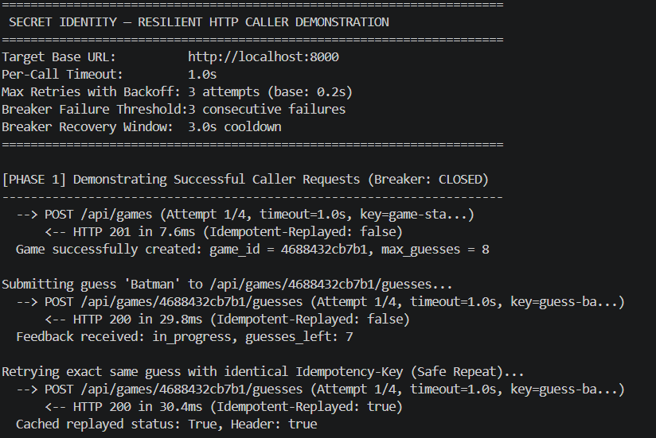

*Figure 6. Happy path. The repeated guess is served from cache (`Idempotent-Replayed: true`). Timeout and breaker settings are printed at the top.*

**Phase 2 — timeout, backoff, trip to OPEN**

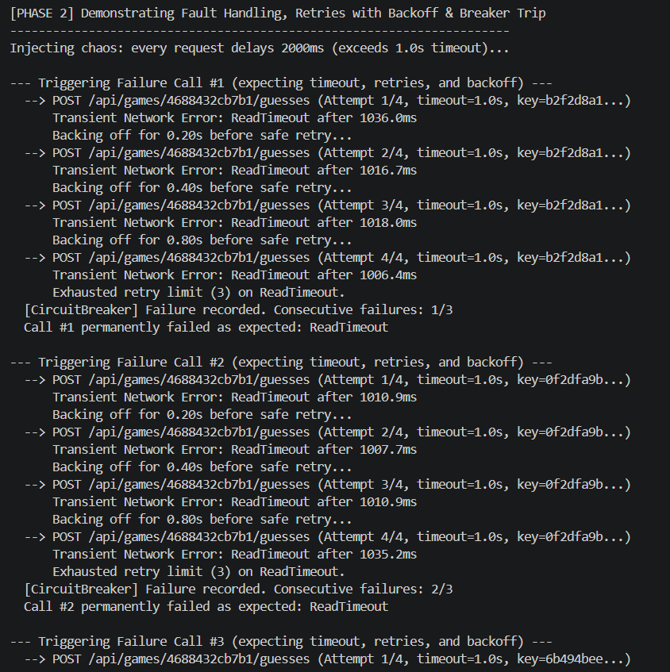

*Figure 7. Three logical calls, each with retries. Consecutive failures 1/3, 2/3, then trip.*

**Phase 3 — block while OPEN; Phase 4 starts recovery**

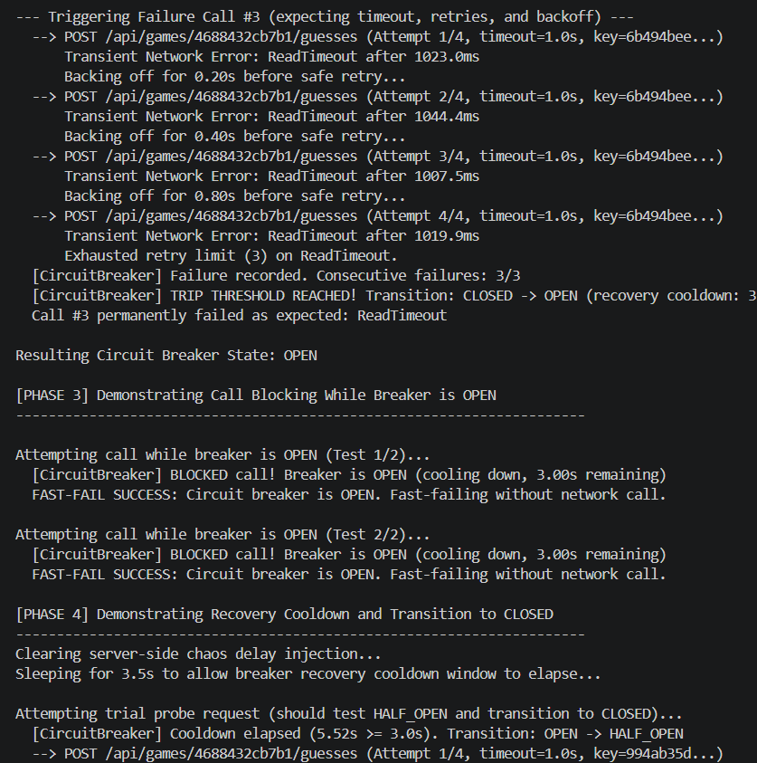

*Figure 8. While OPEN the caller refuses work locally. After cooldown it will probe once.*

**Phase 4 — HALF_OPEN probe, back to CLOSED**

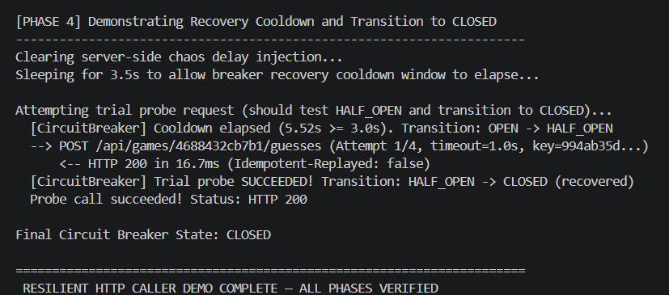

*Figure 9. Probe succeeds, breaker closes. All four phases in one run.*

---

## Part B — gRPC service and metrics

### What I kept, what was missing

I did not redo the A1 “four metric types” exercise. This is only an audit of what that HTTP setup could not see once gRPC existed.

| | A1 | A2 |
| --- | --- | --- |
| Still useful | `http_requests_total`, `http_request_duration_seconds`, `games_active`, win/loss counters | Left in place. Old Grafana boards still work. |
| Missing | No RPC method/status, no 429 counter, no replay counter, no in-flight view, no payload size | Added on the gRPC registry (`:9091`) and two HTTP counters |
| Fix / add | — | `grpc_server_handled_total`, `grpc_server_handling_seconds`, `grpc_server_in_flight_requests`, message-size histograms, plus `http_rate_limit_hits_total` / `*_idempotency_hits_total` |

### Service and `.proto`

`proto/game.proto` defines `SecretIdentityService` with `GetCharacters`, `StartGame`, `MakeGuess`, and `GetGameStatus`. HTTP and gRPC share `app/game-engine.js`, so a guess is judged once.

Generate Python stubs:

```bash
python -m grpc_tools.protoc -I. --python_out=. --grpc_python_out=. proto/game.proto
```

That writes `proto/game_pb2.py` and `proto/game_pb2_grpc.py`. `scripts/grpc_caller.py` uses those stubs. It is the Python gRPC client; it does not expose Prometheus (not required).

Five cycles of mixed OK / `INVALID_ARGUMENT` / `NOT_FOUND` calls populate the boards:

```bash
python scripts/grpc_caller.py 5
```

### Prometheus scrape

`prometheus/prometheus.yml` has a second job:

```yaml
- job_name: secret-identity-grpc
  static_configs:
    - targets: ["app:9091"]
```

HTTP stays on `app:8000`. Both were `UP`:

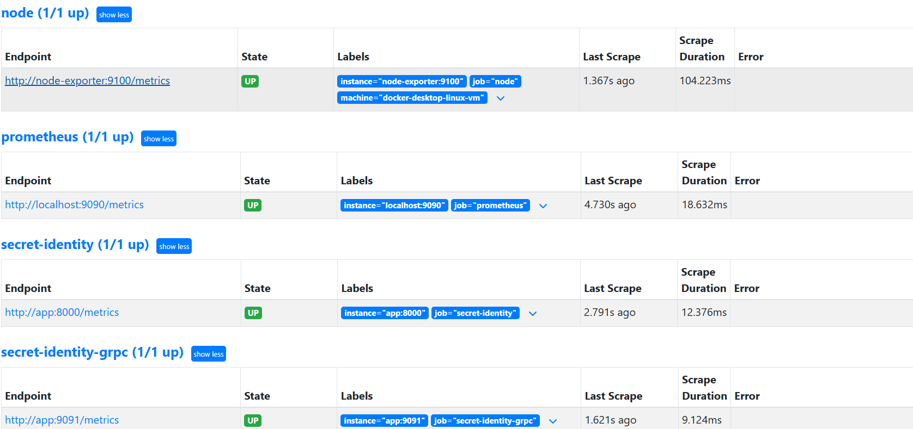

*Figure 10. Prometheus scraping the HTTP app and the gRPC metrics process.*

### New metrics

Duration is measured **on the server**, inside `measureAndExecute` in `app/grpc-server.js`, around the handler. That is handler time, not client RTT.

I used **in-flight calls** as the saturation signal (`grpc_server_in_flight_requests`). If calls sit in the process, this gauge moves; a lone latency quantile can hide that. I still recorded message size because GetCharacters is obviously larger than MakeGuess, and the brief allows either metric.

Labels stay small: service name, four method names, a handful of gRPC codes, HTTP route templates. No user, game, request, or trace ids on series.

| Metric | Purpose | Type | Unit | Labels | Code | Query |
| --- | --- | --- | --- | --- | --- | --- |
| `grpc_server_handled_total` | Volume and errors by method/status | counter | calls | `grpc_service`, `grpc_method`, `grpc_code` | `app/grpc-metrics.js`, incremented in `app/grpc-server.js` | `sum by (grpc_method, grpc_code) (rate(grpc_server_handled_total[1m]))` |
| `grpc_server_handling_seconds` | Latency histogram (p50 / p95) | histogram | seconds | `grpc_service`, `grpc_method` | same | `histogram_quantile(0.95, sum by (le, grpc_method) (rate(grpc_server_handling_seconds_bucket[5m])))` |
| `grpc_server_in_flight_requests` | Concurrent RPCs | gauge | requests | `grpc_service`, `grpc_method` | inc/dec around each handler | `sum by (grpc_method) (grpc_server_in_flight_requests)` |
| `grpc_server_msg_received_bytes` / `_sent_bytes` | Payload size | histogram | bytes | `grpc_service`, `grpc_method` | same wrapper | `histogram_quantile(0.95, sum by (le, grpc_method) (rate(grpc_server_msg_sent_bytes_bucket[5m])))` |
| `grpc_idempotency_hits_total` | Replays on the gRPC path | counter | hits | `grpc_service`, `grpc_method` | `StartGame` / `MakeGuess` | `sum by (grpc_method) (rate(grpc_idempotency_hits_total[1m]))` |
| `http_rate_limit_hits_total` | HTTP `429`s | counter | hits | `route` | `app/server.js` `checkRateLimit` | `sum by (route) (rate(http_rate_limit_hits_total[1m]))` |
| `http_idempotency_hits_total` | HTTP replays | counter | hits | `route` | guess / start handlers | `sum by (route) (rate(http_idempotency_hits_total[1m]))` |

Histogram buckets for RPC time: `0.001 … 2.5` seconds. Message size: `32 … 4096` bytes.

### Dashboard (HTTP beside gRPC)

Grafana dashboard `grafana/dashboards/secret-identity-grpc-comparison.json`, time window on the panels: **5 minutes** for quantiles, **1 minute** for rates.

**Calls and errors, side by side**

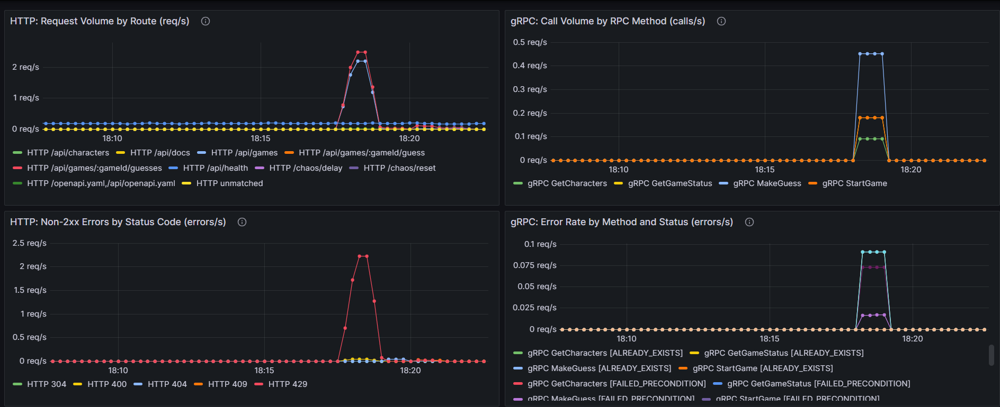

*Figure 11. Left: HTTP. Right: gRPC. The HTTP error panel is the `429` spike from the rate-limit run. gRPC errors are the expected `INVALID_ARGUMENT` / `NOT_FOUND` / `FAILED_PRECONDITION` calls from `grpc_caller.py`.*

**Duration p50 / p95, 429s, in-flight**

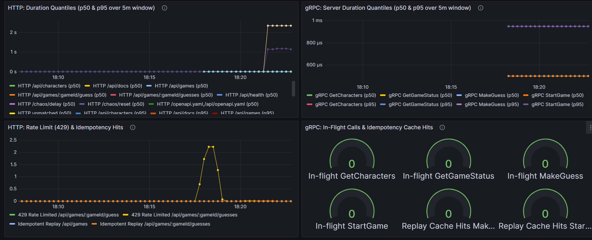

*Figure 12. p50 and p95 over a 5 minute window. The ~2 s HTTP bump is the chaos delay used for the breaker demo, not normal guess time. gRPC handler p95 stays under a millisecond here. Bottom-left is the 429 / replay series; bottom-right is in-flight (idle after the burst) plus replay hits.*

**Message size (extra panel)**

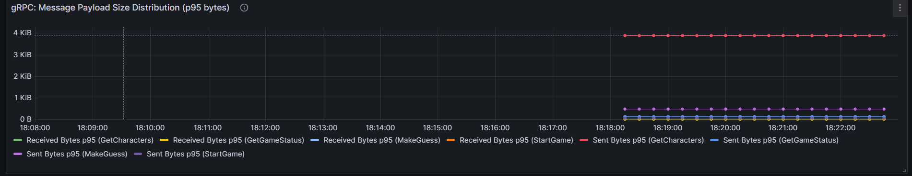

*Figure 13. GetCharacters responses sit near 4 KiB; StartGame / MakeGuess stay tiny. That is why I kept size as a second panel even though in-flight is the saturation metric I would actually alert on.*

---

## Call path

```
Browser  or  python scripts/http_caller.py
        |  HTTP :8000
        v
Express  -> rate limit (guesses) -> idempotency cache -> game engine
        |
        +-> /metrics          Prometheus job secret-identity
        +-> /chaos/delay      (timeout demo only)

python scripts/grpc_caller.py
        |  gRPC :50051
        v
SecretIdentityService  -> same game engine
        |
        +-> metrics HTTP :9091   Prometheus job secret-identity-grpc

Prometheus -> Grafana (HTTP panels | gRPC panels)
```

Both protocols end in the same in-memory map. HTTP adds the IP window and Swagger. gRPC adds protobuf status codes and its own registry so a scrape of `:8000` cannot clobber RPC series.

### HTTP vs gRPC example (same guess)

HTTP:

```http
POST /api/games/4688432cb7b1/guesses HTTP/1.1
Content-Type: application/json
Idempotency-Key: guess-batman-77a8b12c

{"name":"Batman"}
```

JSON body with seven clue objects, `status`, `guesses_left`. Roughly a few hundred bytes.

gRPC:

```text
MakeGuess(game_id="4688432cb7b1", character_name="Batman", idempotency_key="grpc-guess-…")
→ status OK, feedback fields, guesses_left
```

Same clues, typed fields, smaller on the wire. Failures are `INVALID_ARGUMENT` / `NOT_FOUND` instead of HTTP `400` / `404`.

---

## Sources

- ESD Lab 1 (Midnight Launch) and the week 1 gRPC workshop — compose layout, scrape jobs, proto compile command.
- Nygard, *Release It!* — breaker states.
- RFC 6585 / RFC 7231 — `429` and `Retry-After`.

I reused the A1 app, dashboards, and chaos endpoints. New work is the spec, `/guesses`, keys, limiter, Python callers, proto + gRPC server, gRPC registry, and the comparison dashboard.

Run commands live in `README.md`. Data volumes are gitignored (`esdata/`, `prometheus-data/`, etc.).
